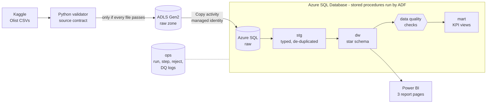

# Azure Retail Intelligence Platform

An end-to-end data engineering project on Microsoft Azure: public e-commerce data is
validated, landed in a data lake, loaded into Azure SQL by Azure Data Factory, modelled
into a tested star schema, and reported in Power BI.

Built with **ADLS Gen2 · Azure Data Factory · Azure SQL Database · Python · T-SQL · Power BI · Git**.



## What it answers

Three report pages for an online marketplace (Olist, Brazil, 2017 – Aug 2018):

| Page | Questions |
|---|---|
| **Sales Performance** | How are product sales, orders, order value and customer numbers trending? Which categories and states drive sales? |
| **Delivery and Operations** | How long do deliveries take, how often are they late, and where? How do review scores differ by delivery outcome? |
| **Customer and Product Insights** | How many customers come back? Which categories sell at what price, and how are their orders reviewed? How do customers pay? |

KPI definitions are in [docs/business_requirements.md](docs/business_requirements.md). The project
deliberately does **not** calculate profit, margin or inventory measures: the data has no cost or stock information.

## Verification status

Every claim in this repository is labelled with how it was verified.

| Capability | Implemented | Locally tested (LocalDB) | Cloud-tested (Azure) | Manually verified |
|---|:-:|:-:|:-:|:-:|
| Source file contract and validator (26 broken-file tests) | ✅ | ✅ | – | – |
| Validated upload to ADLS Gen2 (Entra ID, no keys) | ✅ | – | ✅ | – |
| Raw load, idempotent per batch | ✅ | ✅ | ✅ ADF Copy | – |
| Staging: typing, de-duplication, reject logging, change-only MERGE | ✅ | ✅ | ✅ | – |
| Star schema with incremental (watermark) fact loads | ✅ | ✅ | ✅ full load + rerun | – |
| 28 data quality checks, ERROR checks block the pipeline | ✅ | ✅ | ✅ | – |
| ADF orchestration, run logging, failure handling, validation gate | ✅ | – | ✅ | ✅ ADF monitor |
| Simulated monthly batches = full load (22 objects, 0 differing rows) | ✅ | ✅ | ❌ not run in Azure ¹ | – |
| Power BI model and 3 pages refreshed from Azure SQL | ✅ | – | – | ✅ in Power BI Desktop |
| Power BI Service publishing | ❌ ² | – | – | – |

¹ The Azure database already holds the full load; replaying older simulated batches into it would
roll order statuses back. Running the simulation in Azure needs a second database (see future work).
² Publishing requires a Power BI work or school licence; the report is delivered as a Power BI
project (`powerbi/`) plus exported pages.

**Results (2026-10-28/29):** 119 automated tests pass. CSV → raw → staging reconciles to the row and
to the cent (1,550,924 raw rows; price 13,591,643.70, freight 2,251,909.54, payments 16,008,872.12).
All six mart views are identical between LocalDB and Azure SQL. Details:
[docs/testing_strategy.md](docs/testing_strategy.md).

## Repository layout

```
config/source_schema.yml     source file contract (columns, types, required, patterns)
ingestion/                   validator, ADLS upload, local raw loader, DB connection helper
sql/                         raw, staging, dw, quality, mart and ops layers (re-runnable scripts)
  deploy_manifest.txt        deployment order
adf/                         Data Factory linked services, datasets, pipelines (Git-integration layout)
infra/                       provision.sh / cleanup.sh (Azure CLI)
scripts/                     deploy, local pipeline, ADF deploy/run, batch simulation, Power BI generators
powerbi/                     Power BI project (.pbip): TMDL semantic model + PBIR report
tests/                       pytest suite (file, SQL behaviour, reconciliation, ADF and Power BI definitions)
docs/                        architecture, requirements, data dictionary, model, testing, deployment, decisions
```

## Quick start (local, no Azure needed)

Requires Windows, Python 3.10+, SQL Server Express LocalDB and ODBC Driver 17 for SQL Server.

```bash
python -m venv .venv && .venv/Scripts/pip install -r requirements.txt
cp .env.example .env
python scripts/download_data.py                 # Olist CSVs into data/raw/ (SHA-256 checked)
python scripts/deploy_sql.py                    # creates the local database and all objects
python scripts/run_local_pipeline.py            # validate -> raw -> stg -> dw -> data quality
python -m pytest                                # 119 tests
```

Azure deployment, ADF runs and the Power BI refresh: [docs/deployment_guide.md](docs/deployment_guide.md).

## Cost

All resources are in one resource group in France Central (the student subscription's policy does not
allow North Europe). Azure SQL uses the **free offer** (100,000 vCore-seconds and 32 GB per month,
auto-pausing when the allowance is used up, so it cannot bill). Data Factory is pay-per-use; no Mapping
Data Flows or managed VNet are used. A €10/month budget alert emails at 50 %, 80 % and 100 %.

**Estimated** spend for the whole build: under €1 (six ADF runs at roughly €0.10–0.15 each, from the
Azure retail price list; storage is cents). Actual cost: Azure portal → Cost Management → Cost analysis.

**Clean-up:** `bash infra/cleanup.sh` deletes the resource group (storage, SQL, Data Factory) and the budget.

## Limitations and future work

- The data is a static export. Incremental loading is exercised with **simulated** monthly batches
  replayed from it ([scripts/make_incremental_batches.py](scripts/make_incremental_batches.py)); this is not change data capture.
- An entity with no changes in a batch is rejected (the contract requires ≥ 1 row per file); a real
  feed would need empty deltas to be allowed.
- Dimensions are SCD type 1: the source has no attribute history.
- Timestamps have no time zone and are kept as Brazilian local time.
- Future work: run the simulated batches in a second Azure SQL database; schedule triggers and alerts
  in ADF; CI (GitHub Actions) running the static tests and a LocalDB-free SQL test target; Power BI
  Service with row-level security; at larger scale, Microsoft Fabric / Synapse / Databricks for the
  transformations (deliberately out of scope here for cost and simplicity).

## Data and licence

Olist, *Brazilian E-Commerce Public Dataset by Olist*, Kaggle, CC BY-NC-SA 4.0. The CSV files are not
committed; see [data/README.md](data/README.md). This repository is a non-commercial portfolio project.

## Documentation

[Architecture](docs/architecture.md) ·
[Business requirements](docs/business_requirements.md) ·
[Data dictionary](docs/data_dictionary.md) ·
[Data model](docs/data_model.md) ·
[Testing strategy](docs/testing_strategy.md) ·
[Deployment guide](docs/deployment_guide.md) ·
[Design decisions](docs/design_decisions.md) ·
[Interview notes](docs/interview_notes.md)
