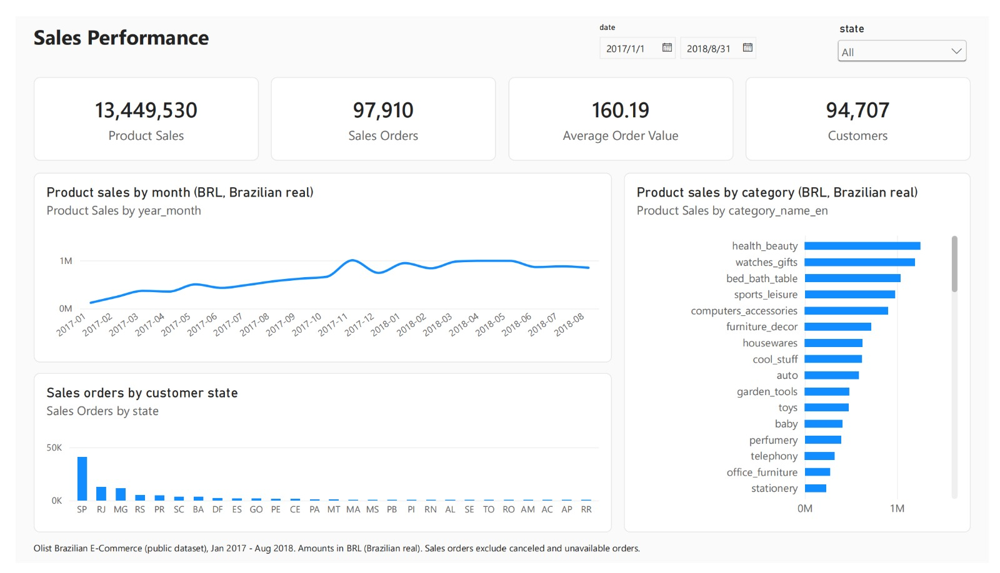
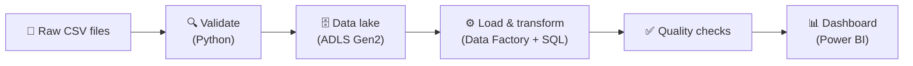
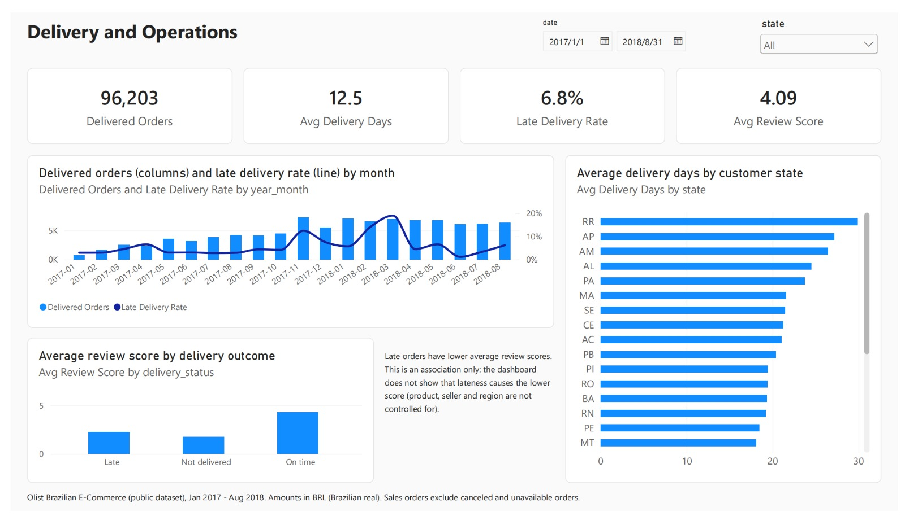
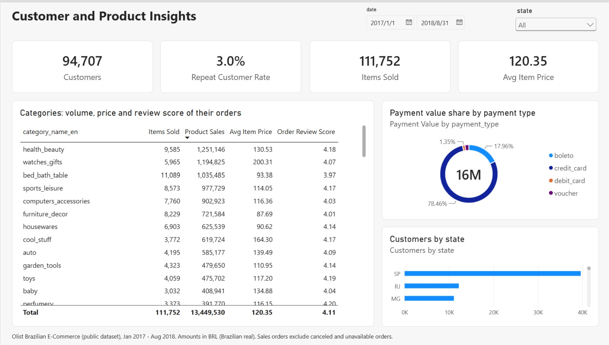
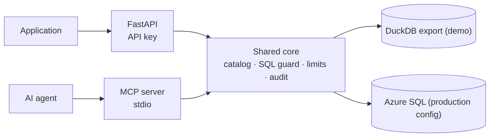
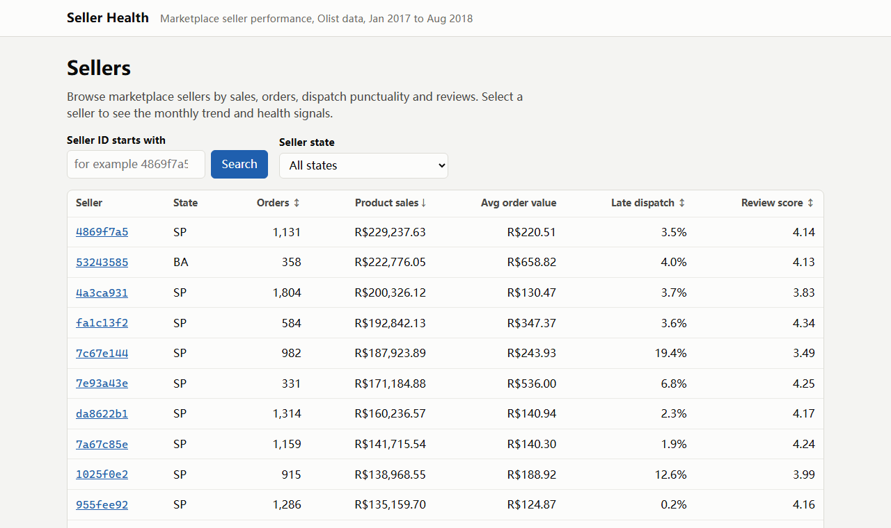
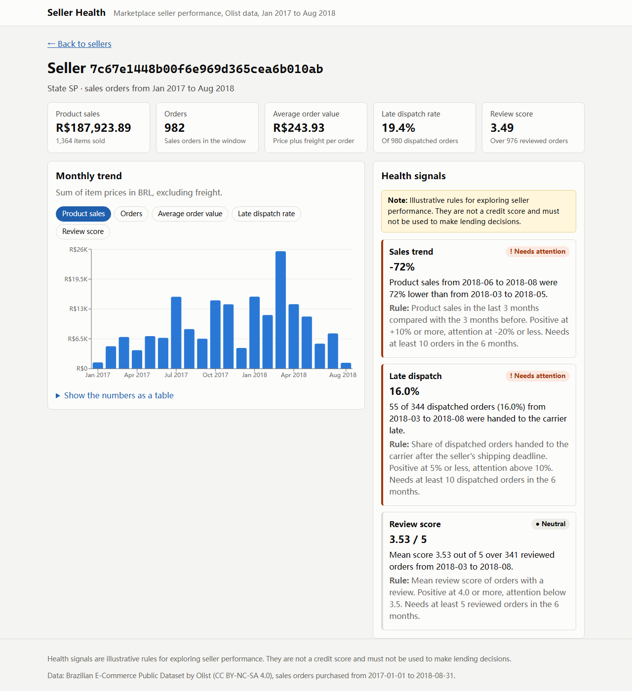
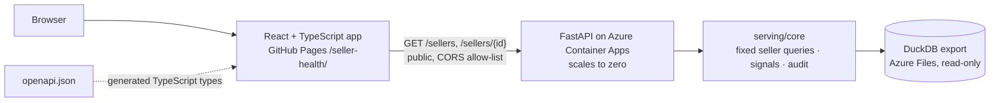

# Azure Retail Intelligence Platform

**Turning 100,000 messy e-commerce orders into trusted, automated business reporting.**

An end-to-end data pipeline that takes raw sales files from an online marketplace, checks them,
loads them into the cloud, models them correctly, and delivers a Power BI dashboard that answers
*how are sales doing, are deliveries on time, and who are our customers?* Every number on the
dashboard reconciles back to the source data to the cent.


### 👉 [Open the live interactive dashboard](https://newnew-niu.github.io/azure-retail-intelligence/)
*Filter by month and state in your browser – no Power BI or sign-in needed.*

### 👉 [Open Seller Health](https://newnew-niu.github.io/azure-retail-intelligence/seller-health/)
*Browse 3,029 marketplace sellers and assess one seller's performance: a React app on a hosted API.*



| 📦 **1.55 M** raw rows from 9 source files | ✅ **125** automated tests, **28** data quality checks per run | 🎯 Reconciled **to the cent** from CSV to dashboard | 💶 Built and run for **under €1** (estimated) |
|:-:|:-:|:-:|:-:|

---

## The problem

[Olist](https://www.kaggle.com/datasets/olistbr/brazilian-ecommerce) is a Brazilian marketplace. Its
public data covers ~100,000 orders split across 9 files: orders, items, payments, reviews, customers,
sellers, products… A manager wants simple answers, but the raw data makes them easy to get wrong:

| What goes wrong with the raw data | What this project does about it |
|---|---|
| Joining items and payments **double counts** money (an order with 3 items and 2 payments becomes 6 rows) | Separate fact tables at the right level of detail, with an automatic check on every run |
| A customer gets a **new ID on every order**, so counting IDs counts orders, not people | Customers are counted by the person ID (96,096 people, not 99,441) |
| Files arrive with **duplicates, gaps and odd values** (775 orders with no items, payments that don't match the bill) | Files are validated before upload; bad rows are logged, known quirks are measured on every run |
| Re-running a load can **duplicate data**, and a failure can leave it **half-loaded** | Every step is safe to re-run and rolls back cleanly on failure |
| New data keeps coming | Only changed orders are reprocessed (incremental loading) |

## The solution



1. **Check** – a Python validator compares every file with a written contract (columns, types,
   formats). Nothing reaches the cloud unless every file passes.
2. **Land** – validated files are uploaded to Azure Data Lake Storage, organised by batch.
3. **Load and transform** – Azure Data Factory copies the files into Azure SQL and runs the SQL
   transformations: clean and type the data, then build a star schema (facts and dimensions).
4. **Verify** – 28 data quality checks run at the end of every load. If the numbers don't
   reconcile, the pipeline stops before anyone sees a wrong report.
5. **Report** – Power BI reads the star schema and shows three pages of business answers.

No passwords or keys exist anywhere: Data Factory signs in with its own Azure identity and the
database accepts Microsoft Entra ID only.

## The dashboard

| Page | Answers |
|---|---|
| **Sales Performance** | Monthly sales trend, order value, top categories and states |
| **Delivery and Operations** | Delivery time, late-delivery rate by month and state, review scores by delivery outcome |
| **Customer and Product Insights** | Repeat customers, category price and volume, payment methods |

The report is built in **Power BI** (screenshots below). Because publishing a public Power BI link needs
an organisational licence, the same three pages also exist as a **[web dashboard](https://newnew-niu.github.io/azure-retail-intelligence/)** (static HTML +
ECharts on GitHub Pages) that uses the same KPI definitions; automated tests check that its numbers equal
SQL and the Power BI cards.

<details>
<summary><b>See the other two pages</b></summary>




All pages as PDF: [docs/images/report.pdf](docs/images/report.pdf)
</details>

**Some findings (Jan 2017 – Aug 2018):** 97,910 orders and 13.4 M BRL in product sales; average
order value 160 BRL; deliveries take 12.5 days on average and 6.8 % arrive late; only 3 % of
customers order more than once. Late orders have lower review scores, which the dashboard presents as
an association, not proof of cause.

## How I know the numbers are right

- **Reconciliation** – row counts, unique keys and money totals match at every layer, CSV → database → warehouse.
- **Quality gate** – 12 blocking checks (e.g. "each order's total equals the sum of its items") and 16
  monitored source anomalies, stored per run in the database.
- **Incremental = full** – the data was replayed as 9 *simulated* monthly batches; loading them one by
  one gives exactly the same warehouse as one full load (0 differing rows across 22 tables and views).
- **Cloud = local** – all business views are identical in Azure SQL and in the local test database.
- **Dashboard = SQL** – every Power BI card was checked against a value computed independently in SQL, and
  automated tests compare the web dashboard's calculations with SQL for the full period and a filtered slice.

## Serving layer

The warehouse also serves applications and AI agents. A [FastAPI service and an MCP
server](serving/README.md) let them discover datasets, read their definitions, check data quality
and run safe read-only SQL. Both call one shared core, so the safety rules cannot differ.



- **Discoverable:** a catalog generated from the project docs gives every dataset's grain, source,
  owner and column definitions.
- **Safe by default:** SQL is parsed, not pattern-matched. Only one SELECT on catalog tables with
  listed functions can run, on a read-only connection, with a row limit, a timeout and an audit log.
- **Proven:** each safety rule was disabled once to prove a test fails (40 changes), and API
  results equal the KPIs computed independently by SQL Server. A real MCP client answered the
  [five demo questions](serving/README.md#five-questions-to-ask-an-agent).
- **Honest scope:** the Azure SQL backend passed 56 checks on the real database, but the service
  has not yet run as the least-privilege reader identity. See
  [what was tested where](serving/README.md#what-was-tested-where).

## Seller Health

A web app for analysts at a company that finances marketplace sellers. They browse the 3,029
sellers with sales in the reporting window, search, filter, sort and page through them, and open
one seller to see its KPIs, a monthly trend and three health signals, each with the rule and the
numbers behind it. The signals are illustrative rules, **not a credit score**.



<details>
<summary><b>See a seller's detail page</b></summary>


</details>



- **No caller SQL:** the seller endpoints run fixed queries. Values are bound parameters, the sort
  comes from an allow-list and pages hold at most 100 rows. `/query` still needs the API key.
- **One set of numbers:** seller KPIs from the API equal independently written SQL on the export
  and the same requests on SQL Server (LocalDB). The hosted API answered 23 of 23 checks with
  responses identical to the local export.
- **Typed end to end:** the web app's types are generated from the API's OpenAPI schema, and CI
  fails if either side drifts.
- **Tested:** 97 tests for the seller API and 65 for the web app (Vitest, Testing Library and a
  mocked API), including loading, error and empty states and shareable URLs. Lint, type checks,
  tests and the build run on every push. Controls are native buttons, links, inputs and radio
  buttons, so they work from the keyboard, and no status is shown by colour alone.
- **Honest scope:** the data is the exported snapshot; the first request after a quiet period waits
  for the API to start (about 5 seconds when measured). Why each choice was made:
  [Seller Health design decisions](docs/seller_health_decisions.md).

## Tech stack

| Area | Tools |
|---|---|
| Cloud | Azure Data Factory, Azure Data Lake Storage Gen2, Azure SQL Database (serverless, free offer), Microsoft Entra ID, managed identity, Azure Container Apps |
| Data | T-SQL stored procedures, star schema, incremental loads with watermarks, data quality checks |
| Code | Python (pandas, pytest, Azure SDK), Bash + Azure CLI for provisioning |
| Reporting | Power BI (DAX, semantic model generated as code); web dashboard (HTML, JavaScript, ECharts) |
| Serving | FastAPI, Model Context Protocol (MCP), DuckDB, sqlglot, Docker |
| Web app | React, TypeScript (strict), Vite, React Router, TanStack Query, Recharts, openapi-typescript |
| Engineering | Git/GitHub, GitHub Actions + Pages, automated tests for the pipeline (125), serving layer (375) and web app (65: Vitest, Testing Library, MSW), SQL Server LocalDB for local development |

---

<details>
<summary><b>Verification status (what was tested where)</b></summary>

| Capability | Locally tested | Tested in Azure | Checked by hand |
|---|:-:|:-:|:-:|
| File validation (26 broken-file tests) | ✅ | – | – |
| Upload to the data lake without keys | – | ✅ | – |
| Raw → staging → star schema, safe re-runs | ✅ | ✅ | – |
| Data quality checks blocking bad loads | ✅ | ✅ | – |
| Data Factory orchestration, logging, failure handling | – | ✅ | ✅ ADF monitor |
| Simulated monthly batches = full load | ✅ | not run ¹ | – |
| Power BI refreshed from Azure SQL | – | – | ✅ |
| Serving layer API, MCP and safety rules | ✅ also on GitHub Actions | ✅ API and safety rules | – |
| Serving layer in Docker | ✅ GitHub Actions, synthetic data only | not run | – |
| Serving layer on Azure SQL, including the reader permissions | ✅ on LocalDB | ✅ 56 checks | – |
| Seller API: endpoints, validation, CORS, health signals | ✅ also on GitHub Actions | ✅ 23 checks on Container Apps ² | – |
| Seller KPIs = independent SQL, and = SQL Server | ✅ real export and LocalDB | – | – |
| Seller Health web app: lint, types, 65 tests, build | ✅ also on GitHub Actions | – | ✅ in Chrome, local API |
| API and web app together in Docker Compose | ✅ GitHub Actions, synthetic data only | – | – |
| Web app on GitHub Pages calling the hosted API | – | ✅ list and detail pages ³ | – |

¹ The Azure database already holds the full load; replaying older batches into it would roll order
statuses back. It needs a second database (future work). Power BI Service publishing needs a work or
school licence, so the report is shared as a Power BI project file plus screenshots.

² `scripts/verify_seller_api.py`, run on 2026-11-18: every list and detail response was identical
to the same request answered from the local export, bad parameters got 422, an unknown seller 404,
the protected endpoints 401 without a key, and CORS allowed the GitHub Pages origin only.
³ Checked on 2026-11-18 after the merge, in headless Chrome: the published page at `/seller-health/`
loaded a filtered, sorted seller list and a seller's detail page from the hosted API across origins.
</details>

<details>
<summary><b>Run it yourself</b></summary>

Local (Windows, Python 3.10+, SQL Server Express LocalDB, ODBC Driver 17):

```bash
python -m venv .venv && .venv/Scripts/pip install -r requirements.txt
cp .env.example .env
python scripts/download_data.py          # Olist CSVs into data/raw/
python scripts/deploy_sql.py             # create the local database
python scripts/run_local_pipeline.py     # validate -> load -> transform -> quality checks
python -m pytest                         # 125 tests
```

Seller Health, after `python scripts/export_serving_db.py` has written `data/serving.duckdb`:

```bash
SERVING_API_KEY=<key> docker compose up --build    # web app on http://127.0.0.1:8080, API on :8000

# or without Docker, in two terminals
SERVING_API_KEY=<key> uvicorn serving.api.main:app --port 8000
cd web && npm ci && npm run dev                     # http://localhost:5173, /api is proxied
```

Hosting the API: `bash infra/seller_api.sh create <image>`; remove it with `bash infra/seller_api.sh delete`.

Azure: `bash infra/provision.sh`, then follow [docs/deployment_guide.md](docs/deployment_guide.md).
Clean up everything with `bash infra/cleanup.sh`.
</details>

<details>
<summary><b>Repository layout</b></summary>

```
config/      source file contract
ingestion/   validator, data lake upload, local loader
sql/         raw, staging, warehouse, quality, mart and ops layers
adf/         Data Factory pipelines (JSON)
infra/       create / delete the Azure resources
scripts/     deployment, pipeline runners, batch simulation, Power BI generators
powerbi/     Power BI project (model + report as text)
dashboard/   web dashboard published to GitHub Pages
serving/     FastAPI service, MCP server and their shared core
web/         Seller Health web app (React, TypeScript)
tests/       automated tests for the pipeline, model and dashboard
docs/        design documentation
```
</details>

<details>
<summary><b>Limitations and next steps</b></summary>

- The source is a one-off export, so incremental loading is shown with **simulated** batches, not
  real change data capture.
- Next steps: scheduled triggers and alerts, CI for the pipeline tests (the serving layer has its
  own workflow), private networking for the database, Power BI Service with row-level security, and Fabric or Databricks for much larger data.
- Seller Health shows a snapshot, has no user sign-in or application-level rate limiting, and keeps
  its audit log inside the container, so the log is lost when the API scales to zero. Health
  signals use fixed thresholds that ignore category and seasonality.
</details>

## Documentation

| | |
|---|---|
| [Architecture](docs/architecture.md) | Components, data flow, security |
| [Business requirements](docs/business_requirements.md) | Questions, KPI definitions, what is out of scope |
| [Data model](docs/data_model.md) | Star schema, grain, incremental loading |
| [Data dictionary](docs/data_dictionary.md) | Every table and column |
| [Testing strategy](docs/testing_strategy.md) | Tests, quality checks, evidence |
| [Design decisions](docs/design_decisions.md) | Why each choice, and the alternatives |
| [Serving layer](serving/README.md) | API, MCP server, safety design, what was tested where |
| [Seller Health decisions](docs/seller_health_decisions.md) | Metric definitions, health signals, API access, front end, hosting |
| [Deployment guide](docs/deployment_guide.md) | Step-by-step setup and clean-up |

---

Data: *Brazilian E-Commerce Public Dataset by Olist* (Kaggle, CC BY-NC-SA 4.0); the CSV files are not
committed ([data/README.md](data/README.md)). Non-commercial project.
