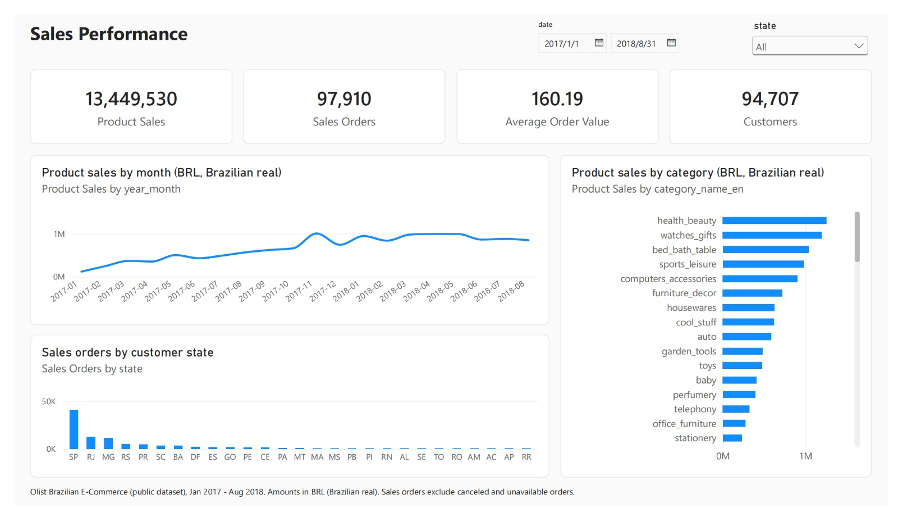
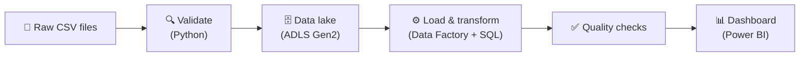
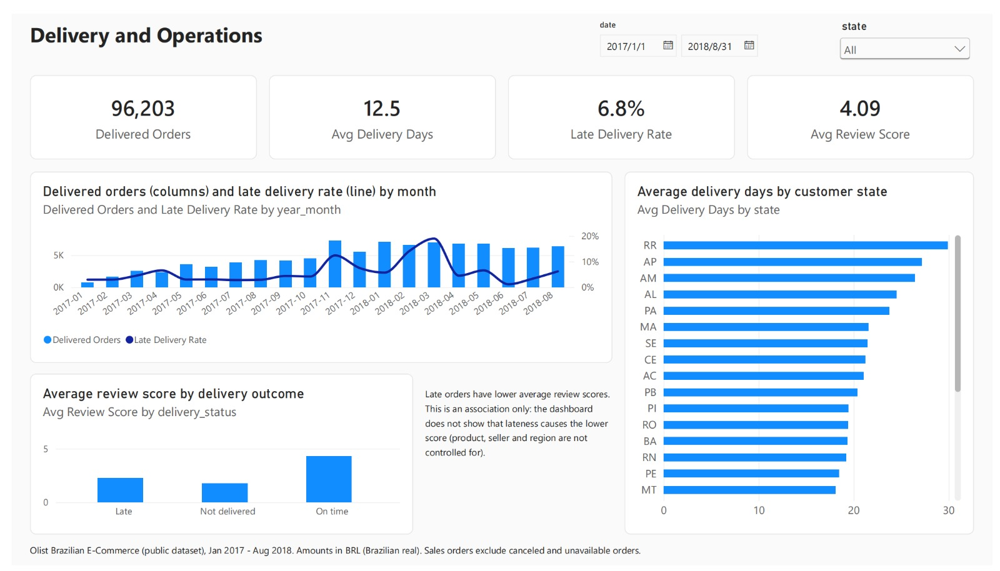
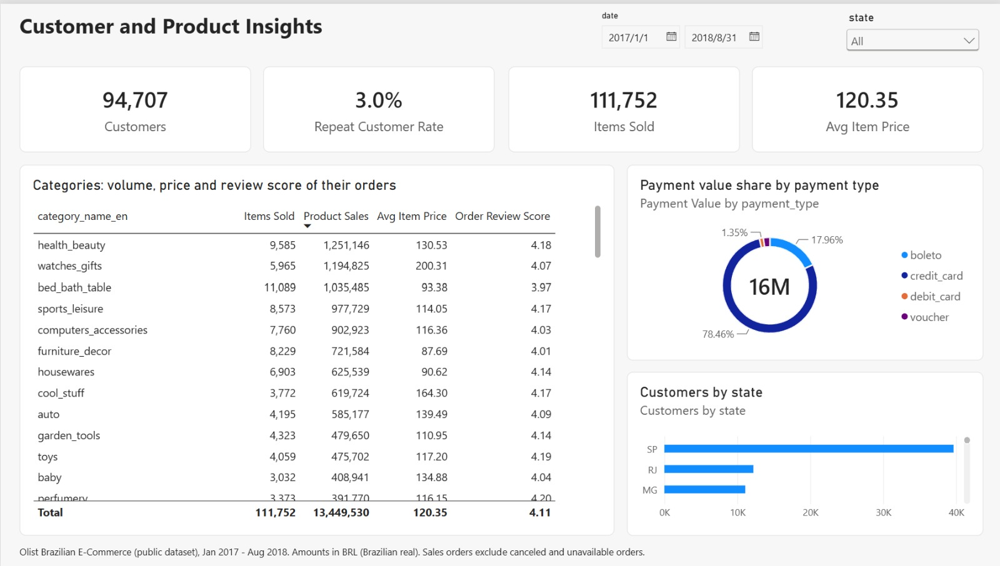

# Azure Retail Intelligence Platform

**Turning 100,000 messy e-commerce orders into trusted, automated business reporting.**

An end-to-end data pipeline that takes raw sales files from an online marketplace, checks them,
loads them into the cloud, models them correctly, and delivers a Power BI dashboard that answers
*how are sales doing, are deliveries on time, and who are our customers?* Every number on the
dashboard reconciles back to the source data to the cent.




| 📦 **1.55 M** raw rows from 9 source files | ✅ **119** automated tests, **28** data quality checks per run | 🎯 Reconciled **to the cent** from CSV to dashboard | 💶 Built and run for **under €1** (estimated) |
|:-:|:-:|:-:|:-:|

---

## The problem

[Olist](https://www.kaggle.com/datasets/olistbr/brazilian-ecommerce) is a Brazilian marketplace. Its
public data covers ~100,000 orders split across 9 files: orders, items, payments, reviews, customers,
sellers, products… A manager wants simple answers, but the raw data makes them easy to get wrong:

| What goes wrong with the raw data | What this project does about it |
|---|---|
| Joining items and payments **double counts** money (an order with 3 items and 2 payments becomes 6 rows) | Separate fact tables at the right level of detail, with an automatic check on every run |
| A customer gets a **new ID on every order**, so counting IDs counts orders, not people | Customers are counted by the person ID (96,096 people, not 99,441) |
| Files arrive with **duplicates, gaps and odd values** (775 orders with no items, payments that don't match the bill) | Files are validated before upload; bad rows are logged, known quirks are measured on every run |
| Re-running a load can **duplicate data**, and a failure can leave it **half-loaded** | Every step is safe to re-run and rolls back cleanly on failure |
| New data keeps coming | Only changed orders are reprocessed (incremental loading) |

## The solution



1. **Check** – a Python validator compares every file with a written contract (columns, types,
   formats). Nothing reaches the cloud unless every file passes.
2. **Land** – validated files are uploaded to Azure Data Lake Storage, organised by batch.
3. **Load and transform** – Azure Data Factory copies the files into Azure SQL and runs the SQL
   transformations: clean and type the data, then build a star schema (facts and dimensions).
4. **Verify** – 28 data quality checks run at the end of every load. If the numbers don't
   reconcile, the pipeline stops before anyone sees a wrong report.
5. **Report** – Power BI reads the star schema and shows three pages of business answers.

No passwords or keys exist anywhere: Data Factory signs in with its own Azure identity and the
database accepts Microsoft Entra ID only.

## The dashboard

| Page | Answers |
|---|---|
| **Sales Performance** | Monthly sales trend, order value, top categories and states |
| **Delivery and Operations** | Delivery time, late-delivery rate by month and state, review scores by delivery outcome |
| **Customer and Product Insights** | Repeat customers, category price and volume, payment methods |

<details>
<summary><b>See the other two pages</b></summary>




All pages as PDF: [docs/images/report.pdf](docs/images/report.pdf)
</details>

**Some findings (Jan 2017 – Aug 2018):** 97,910 orders and 13.4 M BRL in product sales; average
order value 160 BRL; deliveries take 12.5 days on average and 6.8 % arrive late; only 3 % of
customers order more than once. Late orders have lower review scores, which the dashboard presents as
an association, not proof of cause.

## How I know the numbers are right

- **Reconciliation** – row counts, unique keys and money totals match at every layer, CSV → database → warehouse.
- **Quality gate** – 12 blocking checks (e.g. "each order's total equals the sum of its items") and 16
  monitored source anomalies, stored per run in the database.
- **Incremental = full** – the data was replayed as 9 *simulated* monthly batches; loading them one by
  one gives exactly the same warehouse as one full load (0 differing rows across 22 tables and views).
- **Cloud = local** – all business views are identical in Azure SQL and in the local test database.
- **Dashboard = SQL** – every card on the dashboard was checked against a value computed independently in SQL.

## Tech stack

| Area | Tools |
|---|---|
| Cloud | Azure Data Factory, Azure Data Lake Storage Gen2, Azure SQL Database (serverless, free offer), Microsoft Entra ID, managed identity |
| Data | T-SQL stored procedures, star schema, incremental loads with watermarks, data quality checks |
| Code | Python (pandas, pytest, Azure SDK), Bash + Azure CLI for provisioning |
| Reporting | Power BI (DAX, semantic model generated as code) |
| Engineering | Git/GitHub, 119 automated tests, SQL Server LocalDB for local development |

---

<details>
<summary><b>Verification status (what was tested where)</b></summary>

| Capability | Locally tested | Tested in Azure | Checked by hand |
|---|:-:|:-:|:-:|
| File validation (26 broken-file tests) | ✅ | – | – |
| Upload to the data lake without keys | – | ✅ | – |
| Raw → staging → star schema, safe re-runs | ✅ | ✅ | – |
| Data quality checks blocking bad loads | ✅ | ✅ | – |
| Data Factory orchestration, logging, failure handling | – | ✅ | ✅ ADF monitor |
| Simulated monthly batches = full load | ✅ | not run ¹ | – |
| Power BI refreshed from Azure SQL | – | – | ✅ |

¹ The Azure database already holds the full load; replaying older batches into it would roll order
statuses back. It needs a second database (future work). Power BI Service publishing needs a work or
school licence, so the report is shared as a Power BI project file plus screenshots.
</details>

<details>
<summary><b>Run it yourself</b></summary>

Local (Windows, Python 3.10+, SQL Server Express LocalDB, ODBC Driver 17):

```bash
python -m venv .venv && .venv/Scripts/pip install -r requirements.txt
cp .env.example .env
python scripts/download_data.py          # Olist CSVs into data/raw/
python scripts/deploy_sql.py             # create the local database
python scripts/run_local_pipeline.py     # validate -> load -> transform -> quality checks
python -m pytest                         # 119 tests
```

Azure: `bash infra/provision.sh`, then follow [docs/deployment_guide.md](docs/deployment_guide.md).
Clean up everything with `bash infra/cleanup.sh`.
</details>

<details>
<summary><b>Repository layout</b></summary>

```
config/      source file contract
ingestion/   validator, data lake upload, local loader
sql/         raw, staging, warehouse, quality, mart and ops layers
adf/         Data Factory pipelines (JSON)
infra/       create / delete the Azure resources
scripts/     deployment, pipeline runners, batch simulation, Power BI generators
powerbi/     Power BI project (model + report as text)
tests/       automated tests
docs/        design documentation
```
</details>

<details>
<summary><b>Limitations and next steps</b></summary>

- The source is a one-off export, so incremental loading is shown with **simulated** batches, not
  real change data capture.
- Next steps: scheduled triggers and alerts, CI on GitHub Actions, private networking for the
  database, Power BI Service with row-level security, and Fabric or Databricks for much larger data.
</details>

## Documentation

| | |
|---|---|
| [Architecture](docs/architecture.md) | Components, data flow, security |
| [Business requirements](docs/business_requirements.md) | Questions, KPI definitions, what is out of scope |
| [Data model](docs/data_model.md) | Star schema, grain, incremental loading |
| [Data dictionary](docs/data_dictionary.md) | Every table and column |
| [Testing strategy](docs/testing_strategy.md) | Tests, quality checks, evidence |
| [Design decisions](docs/design_decisions.md) | Why each choice, and the alternatives |
| [Deployment guide](docs/deployment_guide.md) | Step-by-step setup and clean-up |

---

Data: *Brazilian E-Commerce Public Dataset by Olist* (Kaggle, CC BY-NC-SA 4.0); the CSV files are not
committed ([data/README.md](data/README.md)). Non-commercial portfolio project.
