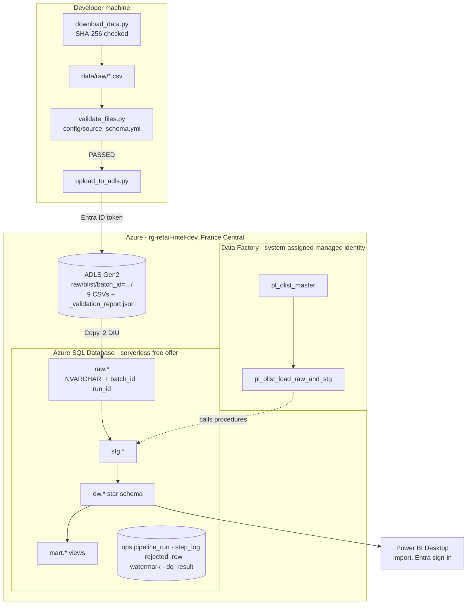
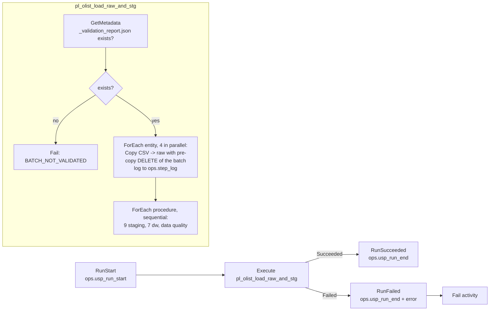

# Architecture

## Overview

The platform is an **ELT** pipeline: files are validated and landed unchanged, loaded into SQL as
text, and every transformation after that runs as version-controlled T-SQL stored procedures inside
Azure SQL Database. Azure Data Factory only orchestrates (copy + call procedures); it holds no
business logic, so the same logic runs locally against LocalDB for development and testing.



## Layers

| Layer | Holds | Written by | Re-run behaviour |
|---|---|---|---|
| ADLS `raw/olist/batch_id=<id>/` | Source files exactly as received + the validator's report | `ingestion/upload_to_adls.py` | Files overwritten |
| `raw` | One table per file, every column `NVARCHAR`, plus `batch_id`, `source_file`, `run_id`, `loaded_at_utc` | ADF Copy (cloud) / `ingestion/load_data.py` (local) | The batch is deleted and re-inserted |
| `stg` | Typed, renamed, de-duplicated; one row per natural key; rejects logged | `stg.usp_load_*` | MERGE writes only changed rows (0 on a rerun) |
| `dw` | Star schema: 4 dimensions, 3 facts | `dw.usp_load_*` | Dimensions: change-only MERGE. Facts: watermark, rebuild affected orders |
| quality | 28 checks → `ops.dq_result` | `ops.usp_run_dq_checks` | Appends one result set per run |
| `mart` | KPI views | – (views) | Always current |
| `ops` | Run, step, reject, watermark and DQ logs | every procedure | Append / upsert |

Why text in `raw`: a load never fails because of a bad value; conversion happens in staging where
each failure can be logged with a reason (`ops.rejected_row`) instead of stopping the whole file.

## Orchestration (Azure Data Factory)



- `run_id` in every log table is the ADF pipeline run ID, so a row in `ops` can be traced to the run
  in the ADF monitor and back.
- The master pipeline is a try/catch: on failure it records `FAILED` with the error, then fails
  itself, so the ADF monitor and `ops.pipeline_run` always agree.
- The validation gate makes a missing or unvalidated batch fail in ~36 s instead of after nine
  failed copies with retries (~6 min, observed before the gate was added).
- The procedure list in ADF is the same list the local runner uses (enforced by a test).

The local runner (`scripts/run_local_pipeline.py`) mirrors this flow against LocalDB and calls the
procedures on an autocommit connection, as ADF does, so each procedure owns its transaction.

## Security

| Concern | Decision |
|---|---|
| Secrets | None exist. Storage has shared-key access disabled (no account keys or SAS); SQL accepts Microsoft Entra authentication only (no SQL logins or passwords). |
| Data Factory | System-assigned managed identity. Storage: *Storage Blob Data Reader* on the account only. SQL: contained user with `SELECT/INSERT/DELETE` on `raw` and `EXECUTE` on `stg`, `dw`, `ops`; no direct access to stg/dw/mart tables, no DDL ([sql/security/adf_access.sql](../sql/security/adf_access.sql)). |
| Developer | `az login` identity: Entra admin of the SQL server; *Storage Blob Data Contributor* for uploads. Python uses an Entra access token from the CLI session. |
| Network | TLS 1.2 minimum. SQL firewall: the developer's public IP + "Allow Azure services" (required by the ADF Azure integration runtime without a managed VNet; the trade-off is documented in [design decisions](design_decisions.md)). Blob public access disabled. |
| Repository | `.env` (resource names only) is git-ignored; committed ADF JSON uses `{{PLACEHOLDERS}}`; a test fails if a credential property or hard-coded hostname appears in `adf/`. |

## Observability

```sql
-- Last runs and their outcome
SELECT TOP 10 run_id, trigger_source, batch_id, status, started_at_utc, ended_at_utc, error_message
  FROM ops.pipeline_run ORDER BY started_at_utc DESC;
-- Steps of one run, with row counts
SELECT step_name, target_object, status, rows_read, rows_written, rows_rejected, error_message
  FROM ops.step_log WHERE run_id = @run_id ORDER BY step_id;
-- Data quality results of one run
SELECT severity, status, check_name, failed_rows, description FROM ops.dq_result WHERE run_id = @run_id;
```

## Environments

| | Local | Azure |
|---|---|---|
| Database | SQL Server Express LocalDB 2022 | Azure SQL Database, serverless GP Gen5 2 vCores, free offer |
| Orchestration | `scripts/run_local_pipeline.py` | ADF `pl_olist_master` |
| Raw load | Python, `fast_executemany` | ADF Copy activity |
| Auth | Windows authentication | Entra ID (user via CLI token; ADF via managed identity) |
| Selected by | `.env` defaults | `SQL_SERVER=<server> SQL_AUTH=azure_cli` |
