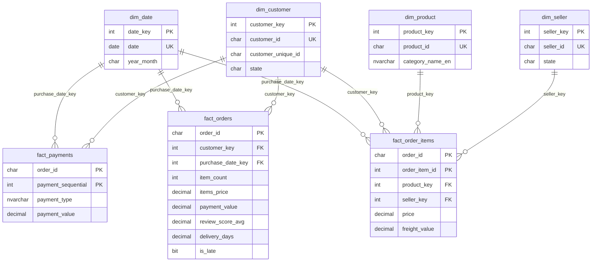
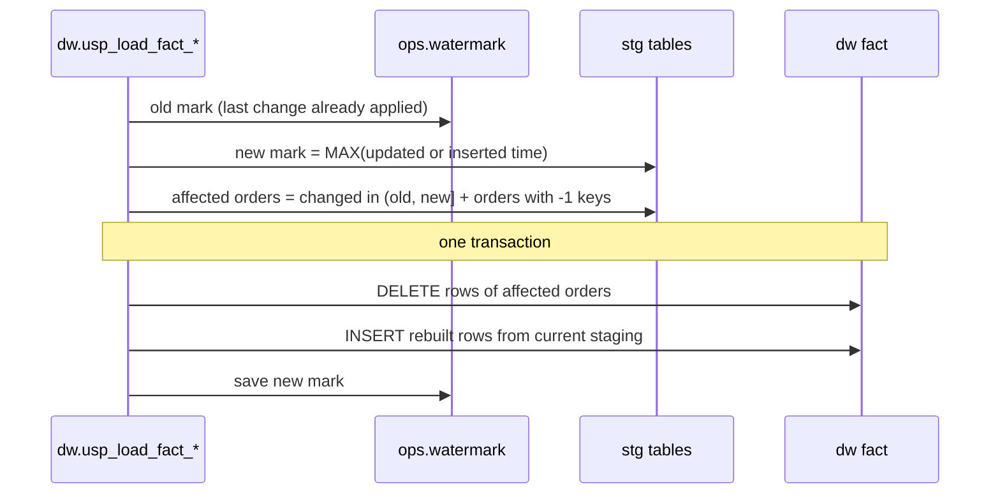

# Data model

## Star schema

Full column lists: [data dictionary](data_dictionary.md).

## Grain

| Table | One row per | Rows (full load) | Key |
|---|---|---:|---|
| `fact_orders` | order | 99,441 | `order_id` |
| `fact_order_items` | order item | 112,650 | `order_id`, `order_item_id` |
| `fact_payments` | payment record | 103,886 | `order_id`, `payment_sequential` |
| `dim_customer` | `customer_id` (= one per order in Olist) | 99,441 + Unknown | `customer_key` |
| `dim_product` | product | 32,951 + Unknown | `product_key` |
| `dim_seller` | seller | 3,095 + Unknown | `seller_key` |
| `dim_date` | calendar day, 2016-01-01 to 2020-12-31 ¹ | 1,827 | `date_key` (yyyymmdd) |

¹ The calendar spans every year that appears in any date column. Four items have a
`shipping_limit_date` in 2020 – a source anomaly, kept as delivered.

## Why three fact tables

Items, payments and reviews are each *many per order*, with no relationship to one another. An
order with 3 items and 2 payments joined in one table gives 6 rows: summing price would count each
item twice and summing payments would count each payment three times.

- Each fact keeps its own grain.
- `fact_orders` carries per-order aggregates (`item_count`, `items_price`, `payment_value`,
  `review_score_avg`). Each is computed from **its own** staging table grouped by order, and only
  then joined 1:1 to the order.
- The data quality suite checks this per order: `fact_orders.items_price` must equal the sum of the
  order's staged items, and the same for payments (ERROR severity).
- In Power BI the facts are not related to each other. A product filter therefore affects item
  measures only; the one measure that crosses grains (*Order Review Score*) does it
  explicitly with `TREATAS` and its description says that an order with several categories counts
  for each of them.

## Customers: `customer_id` vs `customer_unique_id`

Olist issues a new `customer_id` for every order; the person is `customer_unique_id` (96,096 people
for 99,441 orders). `dim_customer` is at `customer_id` grain, so every order keeps the address it was
shipped to, and "Customers" is always `DISTINCT customer_unique_id`. Counting `customer_id` would
count orders.

## Slowly changing dimensions

All dimensions are **type 1** (current values overwritten). The source is a snapshot with no
attribute history, so type 2 would only ever contain one version per key. Surrogate keys are
`IDENTITY` and never change, so attribute updates never require fact rewrites.

## Unknown members and late-arriving data

Each dimension has a row with key `-1` ("Unknown"). A fact whose dimension row is missing gets `-1`
instead of being dropped. Every fact load also re-processes orders that still point at `-1`, so
when the dimension row arrives in a later batch the fact is corrected automatically (tested in
`tests/test_dw_sql.py::test_late_arriving_product_is_resolved_on_the_next_run`). The real data has no
such rows; the DQ check `facts_with_unknown_dimension` reports any that appear.

## Incremental loading

- Staging keeps `inserted_at_utc` / `updated_at_utc`, and its MERGE only touches rows that really
  changed, so "changed since the mark" is exact.
- Rebuilding whole orders keeps all rows of an order consistent (e.g. a status change rewrites every
  item row of that order).
- If the load fails, the transaction rolls back and the mark does not move: the next run retries the
  same changes. A rerun with no changes writes 0 rows.
- Assumption: staging and DW loads do not run concurrently (they run sequentially in one pipeline).

## Power BI semantic model

Import mode, generated as TMDL by `scripts/build_powerbi_model.py`:

- 7 tables from `dw` (load metadata columns excluded); key columns hidden.
- 8 single-direction, many-to-one relationships from dimensions to facts.
- 21 measures, grouped in display folders, each with a description; definitions match the SQL marts.
- *Order Review Score* (category table) averages the orders that contain the items in context, so its
  total (4.11) covers orders with items only, while the *Avg Review Score* card (4.09) covers every
  reviewed order, including canceled orders without items, which score lower.
- `dim_date` is marked as the date table; auto date/time is off.
- Calculated column `dim_date[In Reporting Window]` drives the report-level filter (Jan 2017 – Aug 2018).
- Month axes use `year_month` (`2018-01`), not a formatted date, so labels do not depend on the
  viewer's Windows language.
