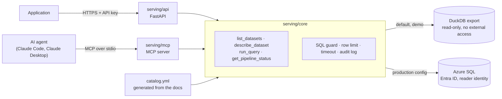

# Serving layer

A secure way for applications and AI agents to discover and query the warehouse. One shared
core sits behind a REST API for applications and an MCP server for agents.



The MCP server does not call an LLM. The agent's client turns a question into tool calls.

| Path | Purpose |
|---|---|
| `core/service.py` | The four operations and the query flow |
| `core/sql_guard.py` | Checks every SQL string before any database sees it |
| `core/backends.py` | DuckDB and Azure SQL connections |
| `core/catalog.py`, `catalog.yml` | Dataset metadata, which is also the allow-list |
| `core/audit.py` | One JSON line per query attempt |
| `api/`, `mcp/` | Thin front ends that translate requests and errors |
| `sql/serving_reader.sql` | Least-privilege Azure SQL identity (not run) |
| `tests/` | Tests on a synthetic database, plus the Docker smoke test |

## What is exposed

| Objects | Through | Why |
|---|---|---|
| 6 `mart` views | `run_query` | KPI definitions are already built in, so agents should start here |
| 3 `dw` facts, 4 `dw` dimensions | `run_query` | Slices the views do not offer, without lineage columns |
| `ops.pipeline_run`, `ops.dq_result` | `get_pipeline_status` only | Operational metadata gets a fixed interface; `error_message` is never exposed |
| `raw`, `stg`, other `ops` tables | Nothing | Implementation details, not data products |

**Reporting window:** the README KPIs cover purchases from 2017-01-01 to 2018-08-31, while mart
views cover all dates. Summing a whole view therefore gives more orders than the README. The
catalog and the MCP instructions tell agents this.

## Run it

Python 3.10, from the repository root. The first three commands need the local LocalDB
database from the main README.

```bash
.venv/Scripts/pip install -r serving/requirements-test.txt
python scripts/export_serving_db.py       # LocalDB -> data/serving.duckdb (git-ignored)
python scripts/build_serving_catalog.py   # only when the docs or the dataset list change
python -m pytest serving/tests            # needs no database or real data
```

### REST API

```bash
python -c "import secrets; print(secrets.token_urlsafe(32))"   # create a key
SERVING_API_KEY=<key> uvicorn serving.api.main:app --port 8000
```

Interactive documentation is at <http://localhost:8000/docs>. It loads Swagger UI from a CDN.

| Request | Purpose | Success | Errors |
|---|---|---|---|
| `GET /health` | Liveness, no key needed | 200 | |
| `GET /datasets` | List datasets | 200 | 401 |
| `GET /datasets/{name}` | Columns, definitions, grain, source, row count | 200 | 401, 404 |
| `POST /query` | One read-only SELECT | 200 | 400 rejected or failed, 401, 422 invalid body, 503 database down, 504 timeout |
| `GET /runs/latest` | Latest pipeline run and data quality | 200 | 401 |

```bash
curl -H "X-API-Key: <key>" localhost:8000/datasets/mart.vw_sales_monthly

curl -H "X-API-Key: <key>" -H "Content-Type: application/json" localhost:8000/query \
     -d '{"sql": "SELECT customer_state, late_rate FROM mart.vw_delivery_by_state ORDER BY late_rate DESC", "limit": 5}'

curl -H "X-API-Key: <key>" -H "Content-Type: application/json" localhost:8000/query \
     -d '{"sql": "DROP TABLE dw.fact_orders"}'
# 400 {"detail":"Only SELECT is allowed, found DROP"}
```

### Docker

```bash
SERVING_API_KEY=<key> docker compose up --build
```

The image holds code only. `data/serving.duckdb` is mounted read-only, the container's own
filesystem is read-only, it runs as a non-root user, and the port is published to this machine
only. The audit log goes to the `serving-audit` volume. The image contains the DuckDB backend
only, because the azuresql backend needs ODBC drivers.

### MCP

Add this to `.mcp.json` for Claude Code, or to `claude_desktop_config.json` for Claude Desktop.
Replace `<repo>` with the absolute path of this repository.

```json
{
  "mcpServers": {
    "retail-intelligence": {
      "command": "<repo>/.venv/Scripts/python.exe",
      "args": ["-m", "serving.mcp.server"],
      "env": { "PYTHONPATH": "<repo>" }
    }
  }
}
```

| Tool or resource | Purpose |
|---|---|
| `list_datasets` | What can be queried |
| `describe_dataset` | Columns, definitions, grain, source, row count |
| `run_query` | One read-only SELECT; the refusal reason is returned so the agent can correct itself |
| `get_pipeline_status` | Freshness and data quality |
| `catalog://retail-intelligence` | The whole catalog as a resource |

### Azure SQL backend

Set `SERVING_BACKEND=azuresql`. The connection uses `ingestion/db.py` and the `SQL_*` settings
in `.env.example`. Agents still write DuckDB SQL, and sqlglot translates it to T-SQL. Before
use, review `sql/serving_reader.sql`, create the identity, and connect as that identity.

## Five questions to ask an agent

1. How did monthly sales develop during 2018?
2. Among states with at least 500 delivered orders, which five have the highest late delivery rate?
3. Do late orders get lower review scores than on-time orders?
4. What were the top five product categories by product sales in the reporting window?
5. Can I trust this data right now? Check the latest pipeline run and data quality.

## Safety design

No single control is trusted alone. If the guard missed something, the database would still
refuse it, and each layer has tests that bypass the other.

**Layer 1: SQL guard (`sql_guard.py`).** It works on sqlglot's parse tree, and the query that
runs is regenerated from that tree, not the caller's text. It is default-deny.

| Rule | Stops |
|---|---|
| Exactly one statement | `SELECT 1; DROP TABLE x` |
| Root must be SELECT | DDL, DML, `COPY`, `ATTACH`, `SET`, `PRAGMA`, `CALL`, `EXPLAIN` |
| No top-level UNION | A limit that would cover only one branch. Wrapping it in a subquery works |
| No `INTO`, no write nodes, no locks | `SELECT ... INTO`, writes inside a CTE, `FOR UPDATE` |
| No comments at all | `SELECT 1 /* ; DROP TABLE x */` |
| Tables must be in the catalog, as `schema.table` | `ops.*`, `information_schema`, file paths, subquery and join tricks |
| No table functions | `read_csv(...)`, `glob(...)`, `query(...)`, `range(...)` |
| Function allow-list | `query()` works even with external access off, so unknown functions are refused |
| Plain LIMIT only, capped | `LIMIT 999999`, `LIMIT -1`, `LIMIT 50%` |
| Maximum 10,000 characters | Oversized input |

**Layer 2: the database connection (`backends.py`).** DuckDB opens the file read-only with
`enable_external_access=false` and `lock_configuration=true`, so SQL cannot switch the setting
back on. SQL Server has no equivalent connection flag, so the azuresql backend relies on the guard,
the reader identity and a transaction that is always rolled back.

**Limits.** The default is 500 rows and the maximum 5,000. One extra row is fetched to report
`truncated: true` honestly. Queries are cancelled after 10 seconds (`SERVING_QUERY_TIMEOUT`).

**Audit log.** `logs/serving_audit.jsonl` receives one line for every attempt: timestamp, client
(`api` or `mcp`), SQL, row count, duration, status (`ok`, `rejected`, `error`) and reason.

**Authentication.** The API compares the `X-API-Key` header in constant time, and refuses every
request if the server has no key. An MCP stdio server has no key: the client starts it as a
local process, so the trust boundary is the machine. Exposing MCP over HTTP would need OAuth.

## What was tested where

| Check | Local (Windows, Python 3.10) | GitHub Actions (Linux) | Azure |
|---|:-:|:-:|:-:|
| 278 tests: endpoints, tools, safety rules, auth, audit | ✅ all pass | ✅ 254 pass, 24 skipped ¹ | – |
| Golden numbers: API = SQL Server baseline = README | ✅ real export | skipped, no real data | – |
| azuresql backend, T-SQL and translation | ✅ on LocalDB | fake connection only | ❌ **not run** |
| Entra ID sign-in, `serving_reader.sql` | – | – | ❌ **not run** |
| Each safety rule disabled to prove a test fails (40 changes) | ✅ all caught | – | – |
| Live uvicorn with curl | ✅ | – | – |
| 8 clients for 20 s: 4,065 requests, no server errors, audit intact | ✅ | – | – |
| MCP over stdio with the SDK client | ✅ | ✅ | – |
| MCP with a real client (Claude Code), including the five questions | ✅ | – | – |
| Claude Desktop | not tested | – | – |
| Docker build, endpoints, read-only mount, clean SIGTERM stop | ❌ Docker not installed | ✅ synthetic data ² | – |
| Docker with the real export | ❌ **not run** | – | – |

¹ The 16 golden-number tests need the real export and the 8 LocalDB tests need SQL Server, so
they skip on CI by design. ² `serving/tests/docker_smoke.sh`, in
[this run](https://github.com/Newnew-niu/azure-retail-intelligence/actions/runs/42225796752):
the container answered every check, kept no data in the image, and exited with code 0 on SIGTERM.

Golden numbers run the same SQL text on both engines. `export_serving_db.py` runs it as T-SQL on
LocalDB and saves the results, and the test runs it through the API on DuckDB. No expected value
is typed by hand.

## Limitations

- **Snapshot, not live:** the DuckDB backend shows the data as of the last export.
- **Windows exit error:** with DuckDB 1.4.4 to 1.5.6, a process that has imported `duckdb` prints
  `Fatal Python error: PyEval_SaveThread` when it receives `CTRL_BREAK`. DuckDB 1.3.2 did not. It
  happens only at exit, so a request in progress at that moment could be lost. It did not happen
  under load, and the Linux container stopped cleanly on SIGTERM. The cause inside DuckDB was not
  found. Version 1.5.6 is kept because DuckDB is a security layer here.
- **SQL translation:** only the T-SQL paths in the tests were exercised. NULL ordering differs
  between engines, and some DuckDB functions may not translate exactly.
- **Timeout, not memory limit:** a very large join can use a lot of memory before it is cancelled.
- **One shared API key:** there are no per-client identities, scopes or rate limits.
- **SQL is read, not understood:** the guard cannot judge whether a query answers the question.
  An agent can still write a valid query that double counts, so the catalog warns about grain.
- **Azure sign-in:** `azure_cli` needs an `az login` session, so a hosted service would need a
  managed identity added to `ingestion/db.py`.
- **`/health` is liveness only:** it does not touch the database.
